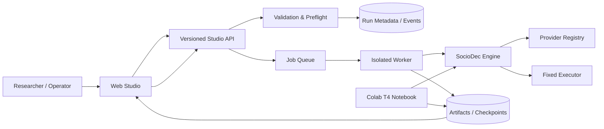

# SocioWeave Studio — Pre-production release gates

**Target:** `preprod-v0.1`  
**Release posture:** gated research preview; not a production benchmark service.  
**Baseline reviewed:** `6aabb815d724273c511db25367ff91bbe9789b12`  
**Date:** 2026-11-23

## 1. Release objective

Deliver two operator-usable surfaces over the same pinned SocioDec Engine:

1. A Google Colab NVIDIA T4 runtime for a reproducible, bounded provider/model smoke and a small explicitly labelled pilot.
2. A Web Studio for configuring a run, validating it before execution, launching a bounded job, monitoring progress, and inspecting immutable run evidence.

A successful build, unit test, configuration preflight, synthetic fixture, or GPU availability check is not a scientific result. The release must preserve that distinction in UI labels, reports, artifacts, and documentation.

## 2. Evidence states (do not collapse)

| State | Meaning | Permitted claim |
|---|---|---|
| `CODE_CI_PASS` | Repository tests and static checks pass at an exact SHA | Software checks pass |
| `CONFIG_PREFLIGHT_PASS` | Frozen inputs/config/provider declarations satisfy local validators; zero live calls | Configuration is internally consistent |
| `T4_INFRA_PASS` | Colab reports T4/CUDA, installs the pinned package, loads pinned model and completes smoke inference | T4 infrastructure smoke passed |
| `PROVIDER_SMOKE_PASS` | Explicitly authorized bounded live provider calls succeed and are fully traced | Provider connectivity smoke passed |
| `PILOT_PASS` | Small preregistered non-E1 pilot completes with executor/assessment evidence | Pilot completed; not E1 evidence |
| `E1_READY` | Dataset provenance, reference annotations, extractor/audit, provider roster, fixed executor, metric adapters, statistical plan and budget all validated | E1 may be authorized |
| `E1_COMPLETE` | Full preregistered E1 grid executed and analyzed with failure accounting and provenance | E1 results may be reported |

No state automatically implies the next. In particular, `T4_INFRA_PASS` is not `PROVIDER_SMOKE_PASS`, and neither is an E1 result.

## 3. Colab T4 acceptance gates

### T4-G1 — immutable environment
- Pin repository commit SHA; never use `main` as the execution reference.
- Pin Python, CUDA/PyTorch compatibility, Transformers, Accelerate, bitsandbytes and all runtime dependencies in a lock/constraints file.
- Record GPU model, memory, CUDA, driver, package versions, timestamp, repository SHA and notebook SHA.
- Install the engine from the pinned checkout and assert `importlib.util.find_spec("sociodec")`.

### T4-G2 — model loading and memory
- Pin model repository and immutable model revision; record license/access class.
- Verify tokenizer/model revision equality and quantization settings.
- Run one deterministic non-scientific smoke prompt.
- Capture allocated/reserved peak VRAM, latency, token counts and finish reason.
- Fail closed on non-T4 GPU when the run is labelled T4.

### T4-G3 — frozen inputs
- Use operator-supplied benchmark files only; no notebook-generated or synthetic replacement.
- Require exact source release/version, split, selection protocol, license approval, structured reference data and SHA-256 fingerprints.
- Require the five registered datasets and their paper-specified counts.
- Smart-administration remains a hard gate until its author-curated 60 examples and practitioner-reviewed annotations are supplied.
- Never infer that a repository license grants rights to the underlying datasets.

### T4-G4 — runtime integration
- Build the direct runtime from the frozen provider manifest.
- Execute deterministic fake-provider integration tests in CI before any live call.
- Exercise one explicitly bounded live method call and one fixed-executor call only after operator authorization and budget display.
- Verify trace completeness, call/token accounting, error propagation, checkpoint resume and artifact integrity.
- Keep V3/V4 as execution-based assessments; structural validation must not promote them to evaluated.

### T4-G5 — evidence export
Persist to Drive and download as a run bundle:
- `run_manifest.json`, pinned code/notebook/model identity and configuration hashes;
- dataset snapshot and reference-data hashes;
- preflight and smoke reports;
- per-call metadata traces (no secrets or raw credentials);
- trial JSONL/checkpoint, failure rows and executor evidence;
- environment, GPU and memory telemetry;
- explicit evidence-state label.

A notebook cell that was not executed must remain visibly pending. No pre-populated success report.

## 4. Web Studio acceptance gates

### Studio-G1 — operator workflow
1. Select dataset snapshot and inspect provenance/license state.
2. Select paper strategy or baseline, model mode and declared model roster.
3. Configure n/k/T, seed, temperatures, token limits, method budget and executor.
4. View estimated method calls, executor calls, token ceiling and expected run scope.
5. Run `Validate before you run`; show blocking errors and warnings separately.
6. Launch only a validated, explicitly confirmed bounded run.
7. Monitor queued/running/succeeded/failed/cancelled state and per-condition progress.
8. Inspect strategy timeline, role/visibility, decisions, decomposition graph, dependency edges, executor results and metric applicability.
9. Export a signed-by-hash run bundle and reproducibility manifest.

### Studio-G2 — API and worker boundary
- UI must not import or duplicate scientific engine logic.
- A versioned API owns configuration validation and job lifecycle.
- A worker executes jobs using the exact same engine/runtime assembly as Colab.
- Persist run state, events, checkpoints and artifacts; support resume only when the full configuration hash matches.
- Do not silently retry failed scientific trials.
- Use an explicit development/local mode with fake providers; live provider mode is disabled by default.
- Secrets are injected server-side from environment/secret storage; never returned to browser, persisted in manifests, or logged.

### Studio-G3 — scientific transparency
- Show paper-defined behavior separately from operational choices.
- Show matcher limitations (current lexical proxy) and metric applicability.
- Display V1/V2/V5 structural checks separately from execution-based V3/V4.
- Label synthetic/demo runs persistently as synthetic.
- Never show empty/pending metrics as zero.
- Preserve failed rows and report missing denominators.

### Studio-G4 — security and operations
- Authentication and per-project authorization before shared deployment.
- Strict upload limits, JSONL schema validation and path traversal protection.
- CORS/CSRF policy, rate limits, request/job IDs and audit events.
- No arbitrary code execution, shell command, notebook execution, or arbitrary URL fetch from browser inputs.
- Resource quotas, concurrency limits, cancellation and cost caps.
- Health/readiness endpoints, structured logs, metrics and backup/restore procedure.

## 5. Proposed deployable topology

Colab is a researcher-controlled execution environment. The Web Studio worker is a separate deployment target; both consume the same pinned engine interfaces and artifact schema. The first pre-production milestone may use a single local worker and SQLite/object-directory storage, but the API/worker boundary must remain explicit so it can be replaced by managed infrastructure later.

## 6. Go/no-go checklist

A pre-production candidate is **NO-GO** if any of these are missing:
- pinned commit and dependency environment;
- green CI for engine, notebook syntax and Web Studio;
- T4 notebook executed by an operator on an actual T4, with report attached;
- provider smoke explicitly authorized and cost-capped;
- deterministic fake-provider campaign integration test;
- complete, provenance-checked dataset/reference bundle for any claimed dataset run;
- Web Studio validation, job lifecycle, trace inspection and export tests;
- security review for secret handling and worker isolation;
- a release note that states exactly which evidence states passed.

A T4 infrastructure pass does not unlock E1. The complete E1 grid remains blocked until the author-curated smart-administration dataset, human review/audit evidence, approved source selection/licensing, exact model-family provenance, dataset-specific reference adapters and paired statistical analysis are all ready.

## 7. Current known blockers and implementation status

- The existing T4 notebook is a preflight, not a direct E1 execution notebook; its pinned code SHA is older than the current baseline and must be refreshed only after CI acceptance.
- The Core 19 notebook explicitly leaves the provider-backed trial adapter unimplemented.
- Historical baseline note: no Web Studio application/API/worker existed at the baseline SHA. Since then PR #66 delivered the API/configuration slice, PR #68 delivered dataset/grid preflight, and PR #69 delivered the researcher-facing preflight workflow.
- Current Studio preflight validates dataset snapshots and the complete condition grid only. It is not the full `DirectE1Runtime.preflight_campaign`, does not validate the 38 provider/model-mode rosters, MA/MB/MC provenance, judge-family separation, fixed executor or S12 prompt-view factory, and is not a connectivity smoke.
- Full E1 remains blocked by smart-administration source/annotations, provider/model provenance, fixed executor configuration, registered S12 Jigsaw facet policy identity, source/annotation/statistical obligations and actual runtime acceptance. A dataset/grid pass is not `E1_READY`.

These are release blockers, not reasons to weaken the scientific gate.

## 8. Delivery sequence

1. Runtime acceptance: fake-provider end-to-end campaign integration, trace and checkpoint contract.
2. Colab T4: immutable environment, actual T4 execution, model smoke, artifacts and evidence review.
3. Web Studio vertical slice: dataset/configuration wizard, validate-before-run, fake-provider job, live trace and export.
4. Provider smoke and bounded pilot: separate explicit authorization, cost cap, no E1 claims.
5. Pre-production hardening: security, persistence, observability, recovery and release candidate.
6. E1 authorization only after all scientific gates pass.
