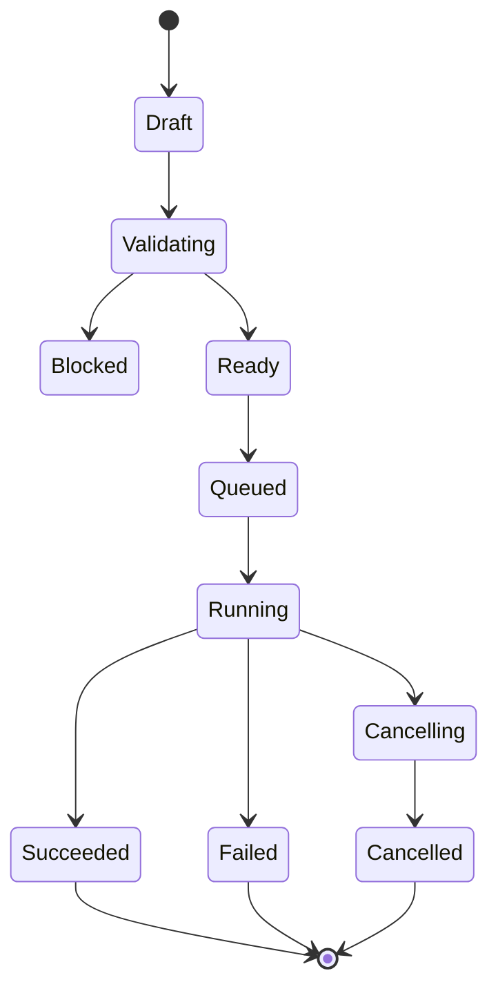

# Web Studio — pre-production product boundary

## Product purpose

SocioWeave Studio is the researcher-facing control and observability plane for SocioDec. It configures and inspects experiments; the SocioDec Engine remains the sole authority for scientific protocol semantics, decomposition, execution, validity and metrics.

## First vertical slice

The first usable increment is intentionally narrow:

- **Workspace / Runs:** recent runs, status, pinned code SHA, evidence state.
- **Dataset registry:** uploaded/frozen snapshot metadata, counts, hashes, license and annotation status.
- **Experiment builder:** method/strategy, baseline pairing, model mode, exact agent roster, n/k/T, seeds, temperatures, token limits, fixed executor and budget preview.
- **Validation panel:** blocking errors, warnings, source-to-paper traceability and a no-live-calls preflight result.
- **Run monitor:** job lifecycle, condition progress, method/executor call split, tokens, latency, failures and cancellation.
- **Trace explorer:** role turns, allowed context, decisions, decomposition nodes/edges, executor outputs and validity evidence.
- **Results:** metric applicability, pending/unavailable states, paired comparisons only when valid, exportable evidence bundle.

## API boundary

Initial versioned API (proposed; implement only with schemas and tests):

| Method | Route | Purpose |
|---|---|---|
| GET | `/api/v1/health` | Liveness |
| GET | `/api/v1/capabilities` | Available methods, baselines, datasets and evidence gates |
| POST | `/api/v1/datasets` | Register uploaded dataset bundle |
| GET | `/api/v1/datasets/{id}` | Inspect provenance and validation |
| POST | `/api/v1/preflights` | Validate configuration; zero provider calls |
| POST | `/api/v1/runs` | Create bounded run from validated immutable config |
| GET | `/api/v1/runs/{id}` | Status and summary |
| GET | `/api/v1/runs/{id}/events` | Progress/event stream |
| GET | `/api/v1/runs/{id}/traces` | Redacted provider and protocol traces |
| POST | `/api/v1/runs/{id}/cancel` | Cooperative cancellation |
| GET | `/api/v1/runs/{id}/artifacts` | Manifest and artifact index |

The routes are a design contract, not implemented endpoints. Every mutation requires an authenticated principal in shared deployments. The API accepts typed configuration only; it never accepts Python, shell, arbitrary imports, provider credentials, or executable notebook content.

## Core entities

- `DatasetSnapshot`: immutable source identity, source release, split, selection protocol, license status, structured-reference hash, prompt hashes and snapshot hash.
- `ProviderAssignment`: agent ID, model ID, family ID, provider organization, access class, immutable revision and access date; secret references are server-only.
- `RunConfig`: exact engine SHA, dataset snapshot SHA, method/baseline IDs, model mode, roster, protocol parameters, budgets and executor identity.
- `PreflightReport`: validation results, blocking issues, warnings, hashes, `live_provider_calls=0`.
- `Run`: immutable config hash, lifecycle state, progress counters and evidence state.
- `RunEvent`: timestamp, sequence, event type, redacted payload.
- `TraceEvent`: agent/role/round, context visibility, prompt/request hashes, provider/model, token counts, latency, decision and output hash.
- `Artifact`: content hash, media type, relative storage key and provenance.

## Run lifecycle

A failed run is terminal unless an operator explicitly creates a new run or resumes from a verified checkpoint under the exact same configuration hash. No in-place silent retry.

## Frontend interaction principles

- Research-console visual language: quiet light canvas, deep navy navigation, indigo primary actions, teal evidence accents; accessible contrast and keyboard navigation.
- Persistent evidence-state chip on every run; never colour a pending or synthetic result as successful evidence.
- “Validate before you run” is the primary action; “Run” remains disabled until blocking errors are cleared.
- Cost/call estimate and fixed-executor calls are shown separately from strategy method budget.
- Every chart/table supports raw observation export and explains metric applicability.
- Empty, pending, failed and not-applicable are distinct states.

## Technology choice

The first implementation should use a typed Python API over the existing Python engine and a separate TypeScript React frontend. A small SQLite-backed job store and local artifact directory are acceptable for a single-operator pre-production deployment. Keep worker execution behind a queue interface and storage behind repository interfaces so production deployment can replace them without changing scientific logic. Pin dependencies and add API contract, frontend, accessibility, security and end-to-end tests before calling it pre-production.

## Explicit non-goals for v0.1

- Multi-tenant commercial SaaS, billing or organization administration.
- Arbitrary agent graph editor or free-form code execution.
- Claiming benchmark performance from demo data.
- Full E1–E9 campaign execution until scientific prerequisites pass.
- Automatic provider/model discovery or unverifiable model-family claims.
